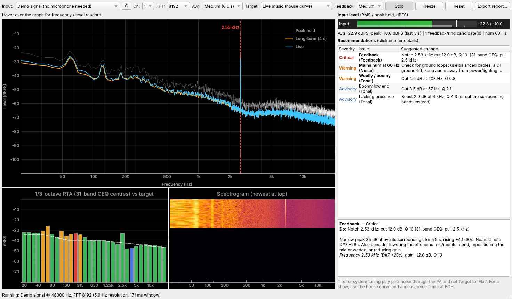

# Live Sound Analyzer (Windows)

A real-time audio spectrum analyzer for live sound engineers. It captures audio from a
microphone (or any sound-card input), draws the frequency response live, and **analyzes
it to tell you what to change**: which frequency is feeding back and how to notch it, where
the mix is muddy or harsh, whether there is mains hum, and whether your input gain is right.



## Features

| Area | What you get |
|---|---|
| **Input** | Any Windows input device (MME, DirectSound, WASAPI, plus ASIO if your PortAudio build has it). Pick a channel or mix all channels. A built-in **demo signal** lets you try everything without a mic. |
| **Spectrum graph** | Log-frequency FFT (20 Hz to 20 kHz, 4k to 32k points) with a live trace, a 4-second long-term average and a decaying peak hold. Hover to read frequency, note name and level. |
| **1/3-octave RTA** | 31 bars at the same centres as a 31-band graphic EQ, coloured by deviation from the target curve (red/orange = too much, blue = too little), with the target drawn as a dashed line. |
| **Spectrogram** | A scrolling waterfall view. Feedback and ringing show up as bright vertical streaks. |
| **Level meter** | RMS bar, peak bar and peak hold, in dBFS. |
| **Recommendations** | A prioritised list (Critical, Warning, Advisory), each with a concrete action and an explanation. |
| **Report export** | Saves a text report (recommendations plus a 1/3-octave table) and a PNG screenshot. |

### What it analyzes and the advice it gives

* **Feedback / ringing.** Looks for narrow peaks that stand well above the surrounding
  spectrum and *persist* for at least a second. A peak that is still growing is marked
  **Critical**. You get a notch suggestion such as `Notch 2.53 kHz: cut 12 dB, Q 10 (31-band GEQ:
  pull 2.5 kHz)`, plus the musical note, so you can find it on a parametric or graphic EQ.
  Peaks that come with harmonics (2f, 3f) are treated as probable musical notes and are not
  reported unless they keep going.
* **Tonal balance.** Compares the long-term 1/3-octave spectrum with a target curve and turns
  broad excesses or deficits into EQ moves with frequency, gain and Q, labelled in engineer's
  terms: *rumble, boomy, woolly, muddy, boxy, honky, harsh, sibilant, fizzy*, or
  *thin, lacking warmth, hollow, lacking presence, dull*. It suggests cutting more readily
  than boosting.
* **Low-frequency rumble.** Too much energy below 40 Hz gives a high-pass filter suggestion.
* **Mains hum.** Steady peaks at 50 or 60 Hz and their harmonics give grounding/DI advice.
  Hum is never reported as feedback.
* **Input level.** Clipping (Critical: the analysis is invalid while clipping), too little
  headroom, or too low a level to analyze.

Target curves:
* **Live music (house curve):** +6 dB of low-end lift below 200 Hz and a gentle 1.5 dB per
  octave roll-off above 1 kHz. Use this during a show.
* **Flat (pink-noise system tuning):** play pink noise through the PA and EQ the system flat.
* **Speech / spoken word:** low end rolled off below 120 Hz.

## Running it on Windows

### Option A: standalone .exe (no Python needed)
Each push to GitHub runs the **Build Windows app** workflow (Actions tab). Download the
`LiveSoundAnalyzer-windows` artifact and run `LiveSoundAnalyzer.exe`.
You can also build it yourself by double-clicking **`build_exe.bat`** (needs Python, see
Option B). The result is `dist\LiveSoundAnalyzer.exe`.

### Option B: run from source
1. Install Python 3.10 or newer from https://www.python.org/downloads/windows/ and tick
   *"Add python.exe to PATH"*.
2. Double-click **`run.bat`**. The first run creates a `.venv` and installs the dependencies;
   later runs start straight away.
   `run.bat --demo` starts directly with the demo signal.

Manual equivalent:
```bat
py -3 -m venv .venv
.venv\Scripts\pip install -r requirements.txt
.venv\Scripts\python LiveSoundAnalyzer.py
```

### Microphone access
If the input opens but shows no signal, open **Settings > Privacy & security > Microphone**
and turn on *"Let desktop apps access your microphone"*. If a device will not open, try the
same device under a different host API (the `[WASAPI]` or `[MME]` entry), or a different
sample rate in the Windows Sound control panel.

## Using it at a gig

1. **Mic:** use an omnidirectional measurement mic (e.g. an ECM8000-type) at the mix
   position, or feed a console aux/matrix into your interface to analyze a single channel.
2. **Gain:** set the input so the meter averages around -30 to -20 dBFS and peaks stay
   below -6 dBFS.
3. **Ring out monitors:** select a wedge's mic, set *Feedback* sensitivity to *High*, and
   slowly raise the gain. Each ring frequency appears in red on the spectrum and as a
   streak in the spectrogram, with the notch to apply. Apply it, then keep raising the gain.
4. **During the show:** use the *Live music* target and *Medium* sensitivity. Watch the
   recommendation list. Tonal advice uses a 4-second average, so it reacts to the overall
   mix rather than to individual notes.
5. **Export report** to keep a record of the room and the settings you made.

Notes:
* The analyzer measures what the *mic* hears. Room position matters, so move the mic around
  to confirm a problem before applying a large EQ change.
* Feedback detection cannot always tell a long, pure held note from feedback. Confirm by ear
  before cutting, especially for items marked *"Sustained tone / possible ring"*.

## Project layout

```
LiveSoundAnalyzer.py      launcher / PyInstaller entry point
livesound/audio.py        mic capture (sounddevice/PortAudio), ring buffer, demo signal
livesound/dsp.py          FFT, averaging, peak hold, 1/3-octave bands, narrow-peak finder
livesound/analysis.py     detectors + recommendation engine (no GUI dependency)
livesound/app.py          PySide6 + pyqtgraph user interface, report export
tests/                    pytest suite driven by synthetic signals
run.bat / build_exe.bat   Windows helpers
LiveSoundAnalyzer.spec    PyInstaller spec
```

Run the tests with `python -m pytest -q tests`.
