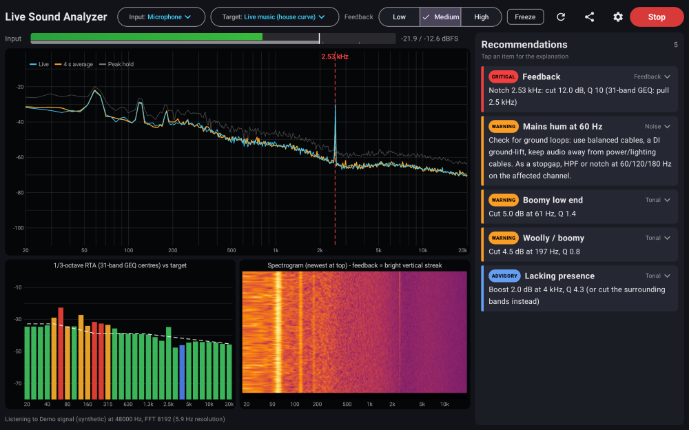

# Live Sound Analyzer for Android (optimized for Galaxy Tab S10 Ultra)

A native Android app (Kotlin + Jetpack Compose) with the same analysis engine as the desktop
and iPhone versions. The layout is designed for the **Samsung Galaxy Tab S10 Ultra**
(14.6", 2960 x 1848, about 1390 x 870 dp in landscape):



* **Landscape (main layout):** level meter and a large spectrum across the top, the 1/3-octave
  RTA and spectrogram side by side below, and the recommendations panel on the right. All
  controls are in one toolbar: input, target curve, feedback sensitivity, freeze, reset,
  share, settings, Start/Stop.
* **Portrait:** graphs stacked above the recommendations, with a two-row toolbar.
* **Split-screen, pop-up window, DeX, phones:** compact layout with an RTA/spectrogram switch
  and a short toolbar.

Works on Android 8.0 or later. The S10 Ultra ships with Android 14, and the app targets
Android 15.

## Features

* **Spectrum:** 20 Hz to 20 kHz on a log axis, with a live trace, a 4-second average and peak
  hold. Feedback frequencies are marked with dashed red lines. **Touch or drag** (finger or
  S Pen) for a frequency, musical note and level readout.
* **1/3-octave RTA** at the 31-band GEQ centres, coloured by deviation from the target curve.
* **Spectrogram:** feedback shows up as a bright vertical streak.
* **Recommendations:** feedback notches (frequency, cut, Q, nearest GEQ slider), tonal EQ
  moves (muddy, boxy, harsh, dull...), rumble/HPF advice, mains hum, and input level. Tap
  a card for the explanation.
* **Measurement-grade input:** uses Android's `UNPROCESSED` audio source when the device
  supports it, or `VOICE_RECOGNITION` otherwise. Both turn off automatic gain control and
  noise suppression.
* **USB-C audio interfaces:** plug in a class-compliant interface with a measurement mic and
  choose it under Settings > Input device.
* **Share report:** sends a text report through Email, Messages, Drive, Notes and so on.
* Keeps the screen on while measuring, stops when the app goes to the background, and
  includes a **demo signal** so you can try it without a mic.

## Install on the Galaxy Tab S10 Ultra (no computer needed)

1. On the tablet, open the repository on GitHub in Chrome or Samsung Internet (you need to
   be signed in), go to **Actions**, open the latest **Build apps** run, and download the
   **LiveSoundAnalyzer-android-apk** artifact.
2. Open **My Files > Downloads**, tap the zip to extract it, then tap
   **LiveSoundAnalyzer-android.apk**.
3. If installing is blocked:
   * **Auto Blocker** (Samsung, One UI 6+): Settings > Security and privacy > **Auto Blocker**,
     then turn it off (you can turn it back on after installing).
   * Allow the app you opened the APK from (My Files or your browser) to
     **Install unknown apps** when prompted.
4. Tap **Install**, open **Live Sound**, press **Start** and allow the microphone.

**From a Windows PC instead:** download the artifact on the PC, unzip it, connect the tablet
with a USB-C cable (choose *File transfer* on the tablet), copy the APK into the tablet's
`Download` folder, then do steps 2 to 4 on the tablet.

**Updating:** install a newer APK over the old one. If Android says the package
*conflicts with an existing package*, the new build was signed with a different key:
uninstall the old version first, or set up a fixed signing key (see below) so every build
installs as an update.

## Tips for the Tab S10 Ultra

* The built-in mics are on the tablet's edges. Point that edge toward the PA and don't cover
  it with your hand or a keyboard cover.
* For system tuning, use a measurement mic through a USB-C audio interface (for example a
  class-compliant 2-channel interface). The tablet's mics are fine for finding feedback and
  big tonal problems.
* If the input stays silent, check the **microphone access** toggle in the quick settings
  panel (swipe down twice).
* In **DeX** or a pop-up window the layout adapts to the window size.

## Building it yourself

Requires JDK 17+ and the Android SDK (Android Studio includes both).

```bash
cd android
./gradlew :app:assembleRelease        # -> app/build/outputs/apk/release/app-release.apk
./gradlew :app:testDebugUnitTest      # engine unit tests + screen renders
./gradlew :app:recordPaparazziDebug   # regenerate the screenshots in app/src/test/snapshots
```

Or open the `android` folder in Android Studio and press Run with the tablet connected
(enable USB debugging under Developer options).

### Optional: fixed signing key, so updates install over the old version

Create a keystore once (`keytool` comes with Java / Android Studio):

```bash
keytool -genkeypair -v -keystore livesound.jks -alias livesound -keyalg RSA -keysize 2048 -validity 10000
```

Then add these **repository secrets** on GitHub (Settings > Secrets and variables > Actions):
`ANDROID_KEYSTORE_BASE64` (output of `base64 -w0 livesound.jks`; on Windows PowerShell:
`[Convert]::ToBase64String([IO.File]::ReadAllBytes("livesound.jks"))`),
`ANDROID_KEYSTORE_PASSWORD`, `ANDROID_KEY_ALIAS` (`livesound`) and `ANDROID_KEY_PASSWORD`.
Keep the keystore file private and backed up. Don't commit it.

## Code layout

```
android/app/src/main/java/com/livesound/analyzer/
  core/      Fft, Dsp (spectrum, bands, peak finder, pooler, ring buffer), Analysis, Signals
             (pure Kotlin: same engine as livesound/ (Python) and ios/LiveSoundCore (Swift))
  audio/     AudioCapture: AudioRecord (UNPROCESSED/VOICE_RECOGNITION), USB device selection, demo
  ui/        MainActivity, AnalyzerViewModel (30 fps loop), AnalyzerScreen (adaptive layouts),
             Graphs (spectrum, RTA, spectrogram, meter), SpectrogramPixels
android/app/src/test/   engine unit tests + Paparazzi renders at Tab S10 Ultra / phone sizes
```
